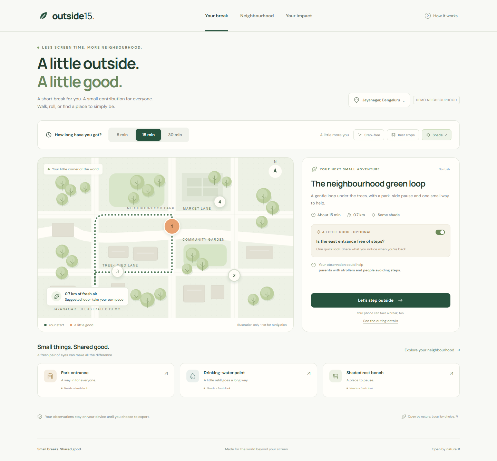

# Outside15

**A little outside. A little good.**

A short outdoor break that leaves your neighbourhood a little better. Choose 5, 15, or 30 minutes, notice one optional amenity, put the phone away, and return with a sentence. An open-weight model organizes that observation; a person checks it before saving.

Started during the October 5–11, 2026 Hacktoberfest Week 1 challenge window. October 12, before the 12:29 p.m. IST deadline: added Gemma/Mastra integration, model evaluation, and GitHub Actions/Pages support. Any later commits must be dated and described here.



### Local edition

Requirements: Python 3.10+, Node.js 22.22+ (recommended for the dependency tree), npm, and a modern browser. Python uses only its standard library. For AI, install [Ollama](https://ollama.com/) and download a model separately.

```powershell
npm.cmd ci
ollama pull gemma3:4b
python server.py
```

Open **http://127.0.0.1:5173**. Ollama normally runs on port 11434. If it is not running, start `ollama serve` in another terminal. Manual entry still works without Ollama.

The development session downloaded Gemma into the ignored `.local/models` directory and used a separate Ollama instance on port **11435**. To reproduce that isolated setup, start Ollama in a separate terminal with the matching model directory:

```powershell
$env:OLLAMA_HOST = '127.0.0.1:11435'
$env:OLLAMA_MODELS = "$PWD/.local/models"
$env:OLLAMA_NO_CLOUD = 'true'
ollama serve
```

Then configure the app terminal (use the same OLLAMA_HOST when pulling weights):

```powershell
$env:OLLAMA_HOST = '127.0.0.1:11435'
$env:OLLAMA_URL = 'http://127.0.0.1:11435'
ollama pull gemma3:4b
python server.py
```

Model and server configuration:

```powershell
$env:OLLAMA_MODEL = 'gemma3:4b'
$env:OLLAMA_URL = 'http://127.0.0.1:11434'
$env:PORT = '5173'
python server.py
```

The default extraction path uses the Mastra workflow. Set `OUTSIDE15_WORKFLOW=direct` to use the Python extractor alone for comparison; direct mode does not use Mastra. You can substitute another Ollama-compatible model that supports structured output. Download it yourself; model weights are not bundled in this repository. Check its license before use.

## What works

- 5/15/30-minute suggestions, optional missions, and preference controls.
- Illustrated Jayanagar demo, plus a real outdoor spot you name yourself without GPS access.
- Phone-away mode with an untimed invitation to return.
- Live local Gemma 3 4B extraction through Ollama’s schema-constrained API, orchestrated by Mastra with a bounded retry and evidence validation.
- Editable fields for amenity, usability, steps, shade, and summary.
- Required human confirmation, dates, preserved original observations, and explicit uncertainty.
- Private browser persistence and a local SQLite backup of confirmed records.
- Neighbourhood filtering/search, JSON export, and contribution history.
- A recent blocked-footpath observation changes the demo’s longer outing suggestion.
- Responsive mobile layouts, keyboard controls, accessible labels, reduced-motion support, self-hosted fonts, and an offline app shell after first load.
- A recorded genuine inference example for the static showcase, clearly distinguished from live AI.

## What the pilot does not claim

The illustrated places, route distances, and stale sample checks are fictional. They must not be used for navigation. The personal-spot option is for a place and route the participant already knows; it does not discover or verify nearby places.

Observations remain private unless exported. There is no public community feed, municipal integration, routing engine, account system, or moderation service in this pilot. A human confirmation is not an independent verification, an accessibility certification, or a claim that water is safe to drink. Conditions can change.

Break time measures time between starting and returning, not verified time outdoors. Recorded-example contributions are excluded from real observation totals. No real-world user study or outdoor field test has been performed by the coding agent.

The hosted static edition cannot call your computer’s Ollama. It offers manual entry and recorded-example replay. Use the local edition for live inference.

## Architecture

```text
Browser: choose break → phone away → write observation
                                   ↓
                   POST /api/extract (not persisted)
                                   ↓
Python → Mastra → local Ollama → Gemma 3 4B → constrained JSON
                                   ↓
               Validate enums + exact evidence quote
               Keep unmentioned access/shade unknown
                                   ↓
                    Person reviews and confirms
                                   ↓
             Browser localStorage + local SQLite
                                   ↓
                  Export JSON when chosen
```

The original note is treated as data in a separate model message. The model has no tools or side effects. Invalid model output fails with a manual-entry option. Extraction never saves a report. `/api/reports` requires an explicitly confirmed, validated record. The server binds to loopback, rejects cross-origin browser writes, limits request size, and uses parameterized SQLite statements.

Storage: `.local/outside15.sqlite3`; browser keys begin `outside15-`. Both remain on the local computer. The database endpoint `GET /api/reports` is a local backup/export source. Data is not encrypted at rest. There are no analytics or third-party map requests; fonts are bundled.


## Credits and license

Outside15 application code and original SVG illustrations: MIT. The current model is Google’s open-weight Gemma 3 4B under the [Gemma Terms of Use](https://ai.google.dev/gemma/terms), not this repository’s MIT license. Model weights are downloaded separately and are not redistributed here. [Mastra](https://github.com/mastra-ai/mastra) orchestrates extraction and review preparation locally. Earlier baseline artifacts used Llama 3.2: Built with Llama, under the separate [Llama 3.2 Community License](https://huggingface.co/meta-llama/Llama-3.2-3B-Instruct). [Ollama](https://github.com/ollama/ollama) provides the local inference runtime. [Playwright](https://github.com/microsoft/playwright) is used for browser checks and capture. DM Sans and Manrope are bundled under their SIL Open Font Licenses in `public/fonts/`.

No photos, external map tiles, or copied application templates are used. Screenshots show this application. AI coding assistance was used to implement and test the project; the field-test worksheet must be completed by a person.
